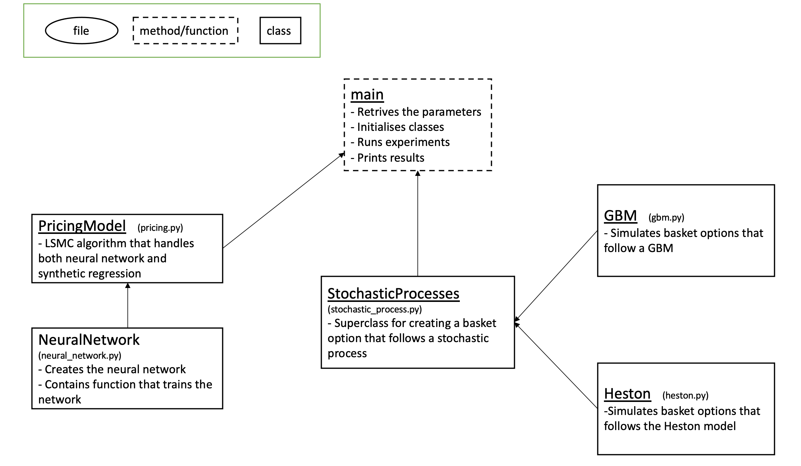

# Neural network-based pricing of high-dimensional Bermudan basket options under stochastic volatility

## Accompanying publication

This repository contains the research code accompanying the following published paper:

Bjørn André Aaslund, Johannes Berge, Ying Ni, and Rita Pimentel (2025). **Neural network-based pricing of high-dimensional Bermudan basket options under stochastic volatility.** *Networks and Heterogeneous Media*, **20**(3), 759–781. https://doi.org/10.3934/nhm.2025032

## Code contributors

The original code was primarily developed by **Bjørn André Aaslund** and **Johannes Berge**, with minor modifications by Ying Ni to support additional numerical experiments.

## Citation

If you use this code or adapt it for your research, please cite the following publication:

```bibtex
@article{Aaslund2025,
  author  = {Aaslund, Bjørn André and Berge, Johannes and Ni, Ying and Pimentel, Rita},
  title   = {Neural network-based pricing of high-dimensional Bermudan basket options under stochastic volatility},
  journal = {Networks and Heterogeneous Media},
  volume  = {20},
  number  = {3},
  pages   = {759--781},
  year    = {2025},
  doi     = {10.3934/nhm.2025032}
}
```

## Motivation

The object of interest in this study is Bermudan basket options with maximum payoffs, i.e., max-call or max-put options on a large number of underlying assets, using the least-squares Monte Carlo (LSMC) approach.

## Structure

    .
    ├── stochastic_processes   # Code for simulating GBM and Heston models
    ├── pricing_methods        # LSMC approach for Bermudan options with different regression methods
    ├── main.py                # Parameter settings and main pricing experiments
    └── README.md

## Visual overview of how the methods/classes interact



## Requirements

- numpy
- TensorFlow 2
- matplotlib

## Running the numerical experiments

The file `main.py` provides the main script for running the numerical experiments using the implementations in `pricing_methods/` and `stochastic_processes/`.

The code is provided in substantially the form used during the research. Running `main.py` with its default settings does not automatically reproduce all the numerical results in the paper. To reproduce different experiments, users need to adjust the model parameters, simulation settings, and pricing method in `main.py` according to the corresponding descriptions in the paper.

In particular, the paper considers neural networks with one, two, and three hidden layers. The number of hidden layers must be adjusted manually in `pricing_methods/neural_network.py` for the relevant experiments. The supplied implementation uses three hidden layers.
